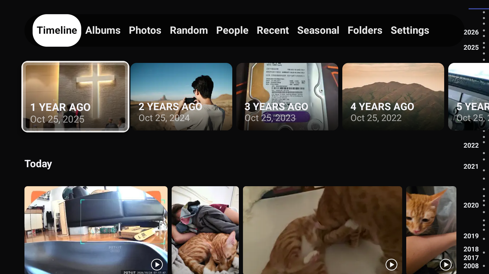
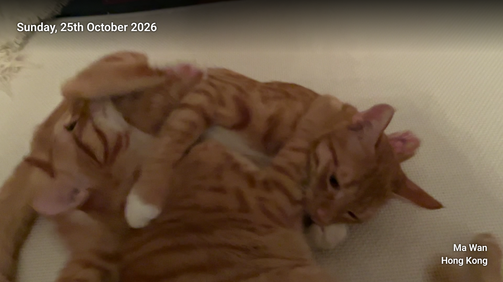
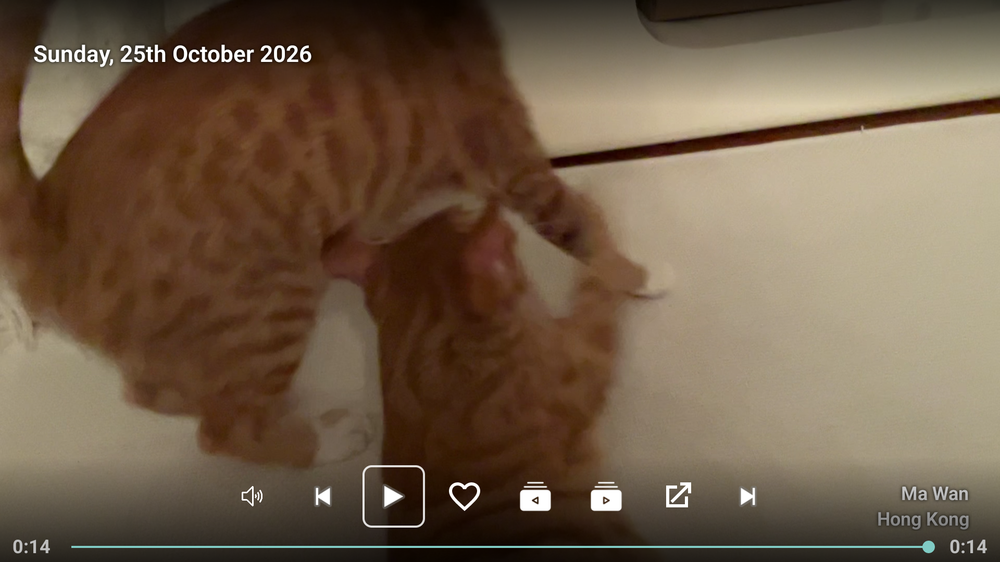
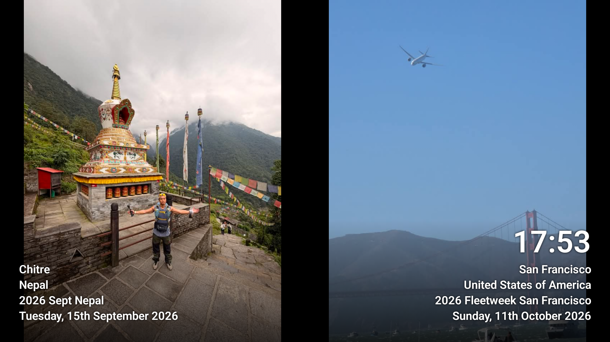
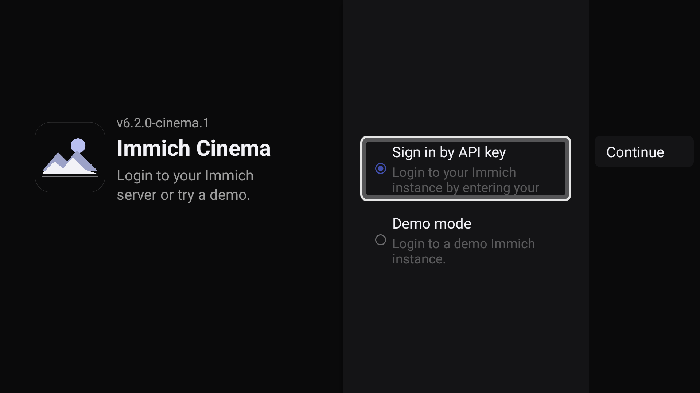

# Immich Cinema

A premium Android TV client for a personal [Immich](https://immich.app) photo and video library.
Built for a television: photography fills the screen, navigation is D-pad only, and nothing is
sized like a phone.

Immich Cinema is an **unofficial** fork of
[`giejay/Immich-Android-TV`](https://github.com/giejay/Immich-Android-TV) (6.2.0 / 148), redesigned
from the navigation shell out. It is not affiliated with, endorsed by, or sponsored by the Immich
project; the name is used descriptively to say it works with an Immich server.

Current release: **6.2.0-cinema.1** — see [Releases](../../releases).

## Screenshots

| Timeline | Viewer |
|---|---|
|  |  |

| Video controls | Screensaver |
|---|---|
|  |  |



## Features

- **Timeline** — full-bleed justified mosaic of your whole library, with a memories rail, day
  headers and a year scrubber. Photos are never cropped here.
- **Albums, Photos, People, Recent, Seasonal, Folders** — 4:3 cards with titles over a scrim,
  and the focused item's artwork filling the background.
- **Viewer** — photos and video, metadata overlay (date, city, country, album), slideshow forwards
  and in reverse, favourite toggle, external player.
- **Screensaver** — the same presentation as the viewer, as a real Android TV daydream.
- **Remote-first** — every action reachable from a D-pad; focus is a white hairline plus a scale
  lift, never colour alone. TalkBack describes cells, tabs and transport buttons.
- **Deep links** — `immichtv://home`, `immichtv://asset/<id>`, `immichtv://album/<id>?name=<name>`.
- **Home-screen channels** — publishes recent photos as an Android TV channel where the launcher
  supports it (Sony's launcher does not render third-party channels).

Sign-in is by API key, or demo mode. The QR "sign in by phone" flow, Firebase analytics and the
upstream donation features are deliberately absent — they depend on infrastructure or Play Console
products that belong to the original author.

## Requirements

- Android TV or Google TV, Android 7.0 (API 24) or newer. Developed and verified on a Sony BRAVIA
  (Android 12, 1920×1080 at 320dpi).
- An Immich server **v3.0.0 or newer**, reachable from the TV, and an API key for it. The key needs
  `asset.read` and `album.read`.

## Install

There is no Play Store listing; install the APK from [Releases](../../releases):

```bash
adb connect <tv-ip>:5555
adb install -r ImmichCinema-6.2.0-cinema.1.apk
```

Launch it once, then enter your server address and API key.

To use it as the screensaver as well:

```bash
adb shell settings put secure screensaver_components \
  com.immichcinema.tv/nl.giejay.android.tv.immich.screensaver.ScreenSaverService
```

The setting only takes effect once the app has been launched at least once.

Because the application id changed from the upstream app (`nl.giejay.android.tv.immich`), Immich
Cinema installs alongside it rather than upgrading it.

## Build from source

Requires JDK 17 and the Android SDK with `compileSdk 37`.

```bash
# debug build
./gradlew :app:assembleDebug

# tests and lint (lint is baselined: it fails only on new issues)
./gradlew :app:testDebugUnitTest :app:lintDebug

# release build: supply your own signing key, nothing is committed
export RELEASE_KEYSTORE_PATH=/path/to/release.keystore
export RELEASE_KEYSTORE_PASSWORD=...
export RELEASE_KEY_ALIAS=...
export RELEASE_KEY_PASSWORD=...
./gradlew :app:assembleRelease
```

The release variant is R8-minified and resource-shrunk; keep the generated
`app/build/outputs/mapping/release/mapping.txt` for the build you ship, or its stack traces cannot
be de-obfuscated.

CI (`.github/workflows/android.yml`) builds and runs the test suite and lint on pushes to `main`
and `redesign`. Releases are cut locally with a locally held key, not by CI.

## Documentation

- [`docs/v2/UI_UX_SPEC_v2.md`](docs/v2/UI_UX_SPEC_v2.md) — the design system and screen specification.
- [`docs/v2/UI_UX_VALIDATION_v2.md`](docs/v2/UI_UX_VALIDATION_v2.md) — release gates, the interaction
  matrix, the screenshot manifest, and the known limitations.
- [`docs/v2/UI_UX_COMPLETION_CHECKLIST_v2.md`](docs/v2/UI_UX_COMPLETION_CHECKLIST_v2.md) — 65
  checklist items with the evidence for each.
- [`docs/releases/`](docs/releases) — per-release notes.
- [`AGENTS.md`](AGENTS.md) — the project's scope, locked decisions and hard rules for contributors.
- [`scripts/branding/generate-icons.ps1`](scripts/branding/generate-icons.ps1) — the icon, banner and
  channel logo are generated from geometry, not stored bitmaps.

## Licence

GPL-3.0 — see [`LICENSE`](LICENSE). The vendored `mediaslider` module keeps its Apache-2.0 licence
([`mediaslider/LICENSE.md`](mediaslider/LICENSE.md)), as do the inherited files that carry Apache
headers. See [`NOTICE`](NOTICE) for what this fork changed and when.

The app icon, TV banner, channel logo and sign-in mark are original artwork. No Immich logo or
wordmark artwork is included.
